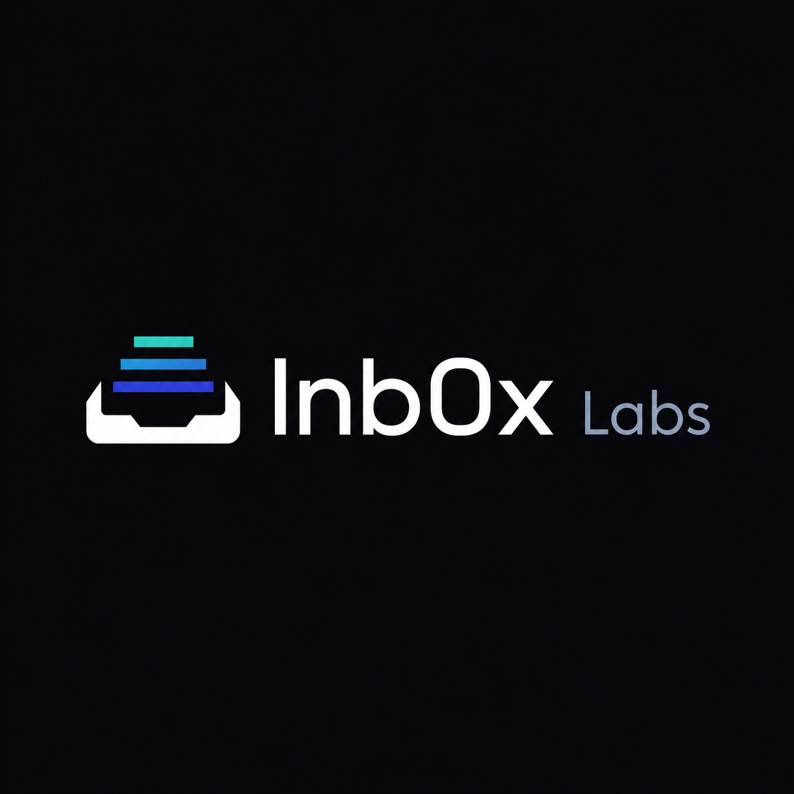

<div align="center">



# Inb0x · Inbox Zero AI

**Email, edited into decisions.**

A read-only Gmail intelligence workspace that helps you find important conversations, understand why they matter, capture accepted tasks, and prepare replies you copy yourself.

**A product by Inb0x Labs · Independent SaaS · Founder-led · Pre-release**

[Product](#product) · [Safety](#privacy-and-user-control) · [Architecture](#architecture) · [Local demo](#run-the-demo) · [Roadmap](#roadmap) · [Security](SECURITY.md)

</div>

---

## Product

Inb0x transforms information overload into a calm attention workbench. It prioritizes persisted email threads, summarizes evidence, identifies possible deadlines, proposes actions, and prepares reviewable drafts. **Nothing is sent or changed in Gmail.**

| Capability | Experience | Boundary |
| --- | --- | --- |
| Priority inbox | Focus on high-impact conversations and response needs | Existing saved and analyzed threads |
| Explainable analysis | Summaries, priority reasons, supporting excerpts, confidence and uncertainty | Explicit user-triggered analysis |
| Deadline and action extraction | Review dates and suggested next steps | Uncertain dates remain marked for review |
| Task ledger | Create, track, complete and reopen tasks | AI suggestions become tasks **only after acceptance** |
| Reply Studio | Generate drafts with tone and length choices | **Copy only**; no sending or Gmail draft creation |
| Insights | Trends, usage, inbox health and completed work | Persisted, bounded workspace metrics |
| Deterministic demo | Explore fictional inbox data without external credentials | Never silently substitutes for real-mode errors |

## Current status

**Pre-release software.** The Next.js application, authenticated route structure, API contracts, demo fixtures and core feature flows exist on the `develop` branch. A premium **attention workbench redesign is planned**, not yet applied to production source.

Real-mode Supabase, Google OAuth/Gmail, OpenAI and hosted deployment require current environment-specific verification. This repository does **not** claim general availability, an independent security audit, Google verification, or a live production release.

- Product and engineering roadmap: [docs/STARTUP_ROADMAP.md](docs/STARTUP_ROADMAP.md)
- Codex development instructions: [docs/CODEX_HANDOFF.md](docs/CODEX_HANDOFF.md)
- Frontend rules: [DESIGN_RULES.md](DESIGN_RULES.md)
- Deployment gates: [docs/PRODUCTION_CHECKLIST.md](docs/PRODUCTION_CHECKLIST.md)
- Detailed security model: [docs/SECURITY.md](docs/SECURITY.md)

## Privacy and user control

Inb0x requests **Gmail read-only** authorization for its mailbox connection. It must never send, delete, archive, relabel, mark email as read, create Gmail drafts, download attachments, or trigger autonomous mail actions.

Analysis and draft generation are explicit actions, not background activities. Suggested tasks are not created automatically. Email is treated as untrusted content; AI evidence, warnings, and uncertain claims must remain visible. Provider credentials and tokens stay server-side. See [SECURITY.md](SECURITY.md).

## Architecture

| Layer | Stack |
| --- | --- |
| Web | Next.js 16 App Router, React 19, TypeScript, Tailwind CSS 4 |
| Identity and data | Supabase Auth, PostgreSQL, Row Level Security |
| Mailbox connection | Google OAuth 2.0, Gmail API (`gmail.readonly`) |
| AI | OpenAI Responses API, structured outputs, Zod validation |
| Testing | Vitest, React Testing Library, Playwright, ESLint, Prettier |
| Deployment target | Vercel |

```text
src/app/                  Marketing, auth, protected application, API routes
src/components/           Shared and domain-specific user interface
src/server/               Trusted services, provider integrations and repositories
src/lib/api-client.ts     Typed browser-to-API boundary
src/types/contracts.ts    Public application contracts
src/mock/                 Deterministic fictional demo data
supabase/                 Database migrations, policies and tests
docs/                     Architecture, security, setup and release procedures
```

Protected routes include `/dashboard`, `/inbox`, `/inbox/[threadId]`, `/tasks`, `/drafts`, `/insights`, and `/settings`. The landing page and sign-in experience have separate routes. Do not invent functionality that the existing contracts do not support.

## Run the demo

Requirements: **Node.js 20.9+**, npm, and Git. The `develop` branch is the current application integration branch; `main` remains the stable branch and may lag until an approved release.

```bash
git clone https://github.com/Z1esco/Inb0x-Labs.git
cd Inb0x-Labs
git switch develop
npm ci
cp .env.example .env.local
# Set DEMO_MODE=true in .env.local
npm run dev
```

Open http://localhost:3000. On Windows PowerShell, replace the copy command with `Copy-Item .env.example .env.local`.

Demo mode is fictional and deterministic and does not require live Gmail, OpenAI or Supabase credentials where fixture mode is supported. For real-mode configuration follow [docs/SETUP.md](docs/SETUP.md), [docs/ENVIRONMENT.md](docs/ENVIRONMENT.md) and [docs/GOOGLE_OAUTH.md](docs/GOOGLE_OAUTH.md). Never commit `.env.local`, tokens or provider secrets.

## Quality and development

```bash
npm run format:check
npm run lint
npm run typecheck
npm test
npm run build
npm run check
```

The full check combines formatting, lint, typecheck, tests and build. Browser, hosted-provider, and production-security verification are separate release gates. The existence of CI or previous test results is not evidence that a new change has passed.

**Solo-founder workflow:** one accountable maintainer, separate scoped feature branches and reviewable draft PRs. AI coding tools can implement changes but do not approve security, production deployments or destructive migrations. Read [AGENTS.md](AGENTS.md), [PROJECT_RULES.md](PROJECT_RULES.md), and [CONTRIBUTING.md](CONTRIBUTING.md).

## Roadmap

- [x] Secure application foundation, contracts and deterministic demo
- [x] Read-only Gmail integration, on-demand analysis, accepted tasks and copy-only drafts implemented in code
- [x] Dashboard, inbox, tasks, drafts, insights and settings routes implemented
- [ ] Complete the approved premium attention workbench frontend redesign
- [ ] Revalidate all automated checks and end-to-end demo journeys on current code
- [ ] Verify hosted Supabase isolation, a dedicated Gmail account and real OpenAI flows
- [ ] Complete privacy, consent-screen and release-readiness checks
- [ ] Deploy a limited beta only after explicit release approval

See [the detailed roadmap](docs/STARTUP_ROADMAP.md) for sequencing and exit criteria.

## Ownership, security and license

**Inb0x Labs is operated by a solo founder.** Architecture, delivery, security and release decisions remain owner-approved; Codex is a development tool, not an independent maintainer. See [docs/OWNERSHIP.md](docs/OWNERSHIP.md).

Report vulnerabilities privately using [SECURITY.md](SECURITY.md). Do not disclose real email content, tokens or exploit details in public issues.

**License:** This repository currently carries the [MIT License](LICENSE). The permission grant is broader than the proprietary license used by some commercial startups; changing the license requires an intentional decision, not a cosmetic GitHub refresh.
